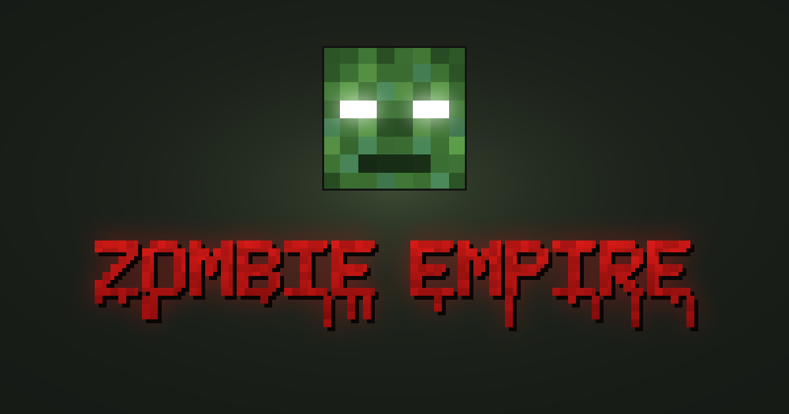

  <a href="https://zombieempire.rf.gd"><b>🌐 Website</b></a> ·
  <a href="https://github.com/masterbudzreal/zombie-empire/releases/latest"><b>⬇ Download</b></a> ·
  <a href="https://www.paypal.com/donate/?business=masterbudz01%40gmail.com&currency_code=EUR&item_name=Zombie+Empire"><b>♥ Donate</b></a>

# Zombie Empire

Free zombies modpack for **Minecraft Java 1.21.1** (NeoForge 21.1.215): custom boss map, modern guns, original soundtrack, official server or instant LAN.

## Download

**[⬇ Latest release](https://github.com/masterbudzreal/zombie-empire/releases/latest)** – Windows 10/11 64-bit · a legit copy of Minecraft: Java Edition is required

| Version | File | Install |
|---|---|---|
| **Standard** | `Zombie-Empire-v1.1-Standard.zip` | Run `ZombieEmpire-Setup.exe` → **INSTALL & PLAY**. Own launcher, auto-joins the official server, shortcuts and uninstall from Windows Settings. |
| **Lite** | `Zombie-Empire-v1.1-Lite.zip` | Run `install.bat`. Installs the official NeoForge into `versions\`, the mods into `mods\` and a **Zombie Empire** profile into the launcher you already use. |

Mods are downloaded from Modrinth during install; Minecraft and NeoForge come from their official sources.

Official server: `zombieempire.serveminecraft.net`

## Repository

| Folder | What's inside |
|---|---|
| [`site/`](site) | The website live at [zombieempire.rf.gd](https://zombieempire.rf.gd). Pushing changes here deploys it automatically ([workflow](.github/workflows/deploy-site.yml)). |
| [`launcher/`](launcher) | `ZombieEmpire.exe` (C#): server check, hub/game mode reset, mod download, starts Prism Launcher. |
| [`installer/`](installer) | `ZombieEmpire-Setup.exe` (C#): Standard installer with the game embedded, shortcuts, uninstaller. |
| [`lite/`](lite) | `install.bat` / `install.ps1`: Lite installer for any `.minecraft` launcher. |
| [`mod/`](mod) | The Zombie Empire NeoForge mod: soundtrack, welcome title, automatic LAN. |
| [`tools/`](tools) | Python scripts: soundtrack composer, icon and website art, NBT helpers, Lite packager. |
| [`assets/`](assets) | Icon (PNG / ICO). |
| [`mods.txt`](mods.txt) | Third-party mods: SHA-1, file name and Modrinth download URL. |
| [`CREDITS.txt`](CREDITS.txt) | Mod authors and licenses. |

How to build everything: [BUILD.md](BUILD.md).

## Credits

Standard is built on [Prism Launcher](https://prismlauncher.org) (GPL-3.0). Third-party mods are **not** included in this repository or in the downloads: they are fetched from [Modrinth](https://modrinth.com). Full list of authors and licenses in [`CREDITS.txt`](CREDITS.txt).

NOT AN OFFICIAL MINECRAFT PRODUCT. NOT APPROVED BY OR ASSOCIATED WITH MOJANG OR MICROSOFT.
